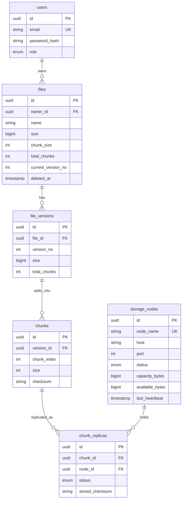

# Database design

Source of truth: `packages/db/prisma/schema.prisma`.

## Other tables

- `events`: append-only log (node offline, recovery, fault injection, uploads) shown on the dashboard.
- `benchmark_runs`: reserved for recorded benchmark results; the current `scripts/benchmark.mjs` prints results to the console and does not write to it yet.

## Constraints and indexes

- `(file_id, version_no)`, `(version_id, chunk_index)` and `(chunk_id, node_id)` are unique, so a chunk can never have two replicas on the same node.
- Deleting a file version cascades to its chunks and replicas.
- Indexes on owner, file, version, node, event type and event time.

## Enums

- `UserRole`: USER, ADMIN
- `NodeStatus`: HEALTHY, OFFLINE, DECOMMISSIONED
- `ReplicaStatus`: PENDING, HEALTHY, CORRUPT, MISSING, QUARANTINED
